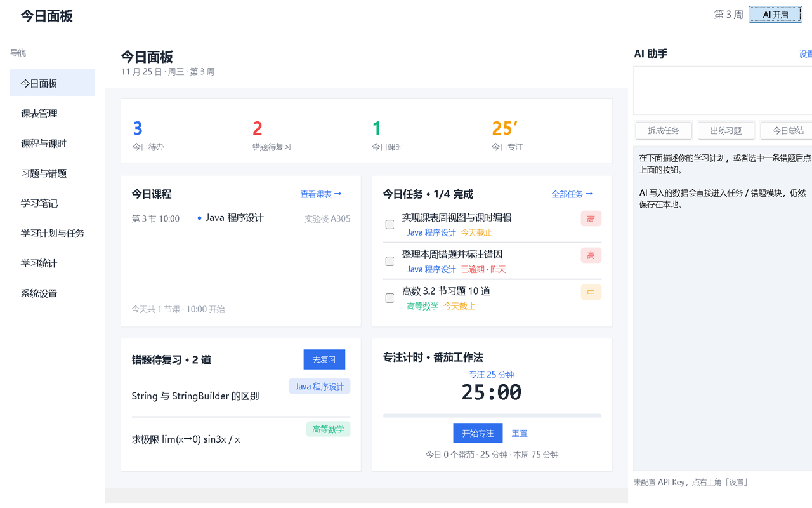
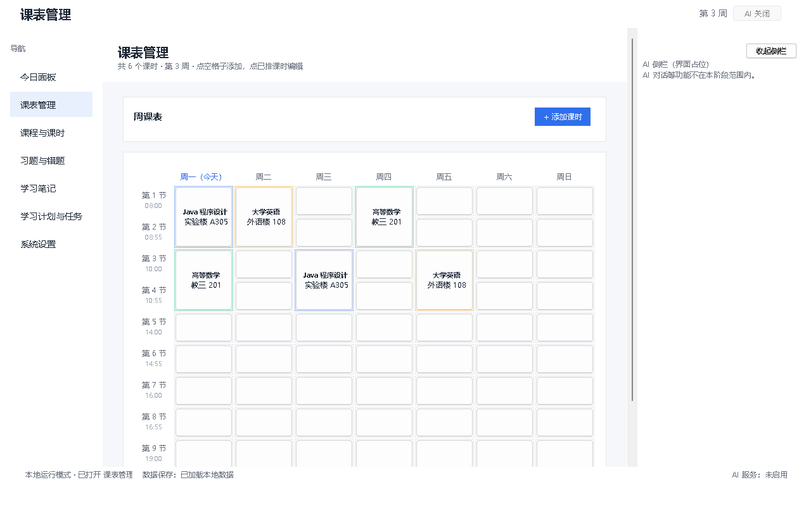
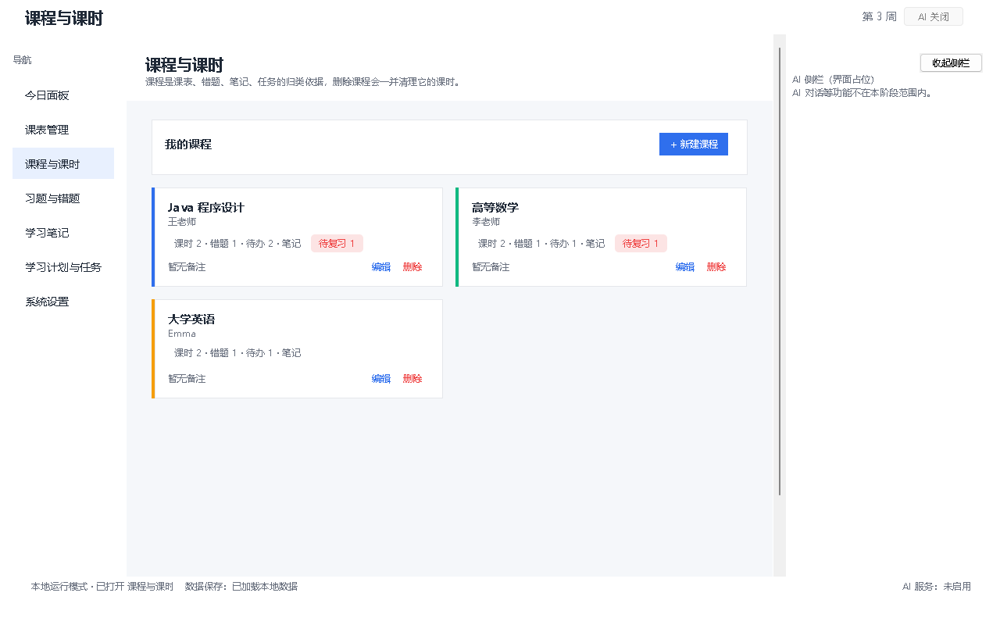
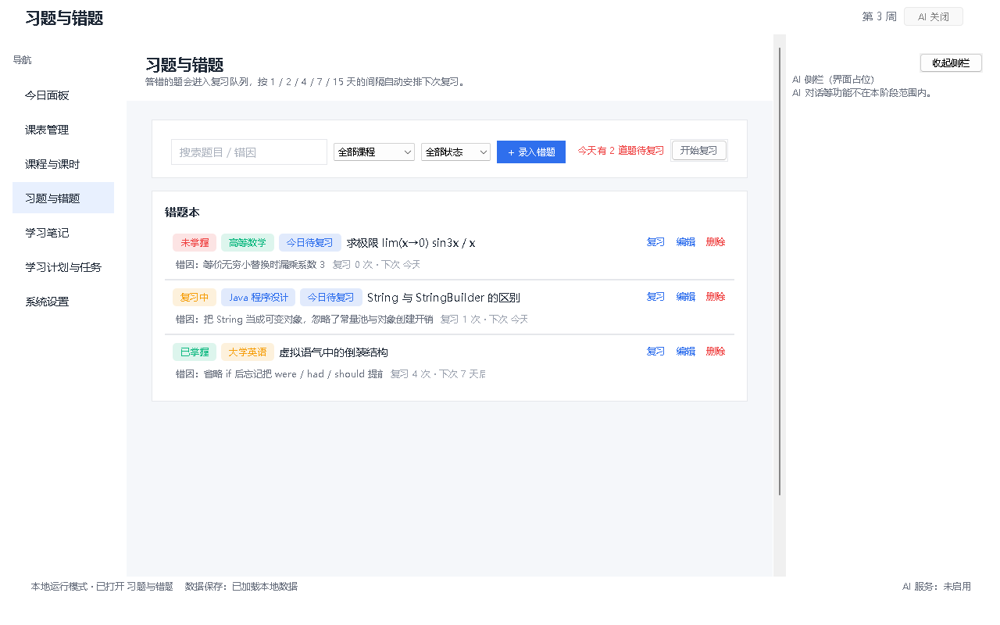
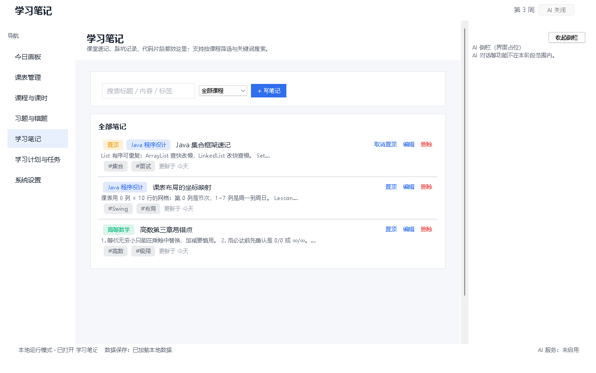
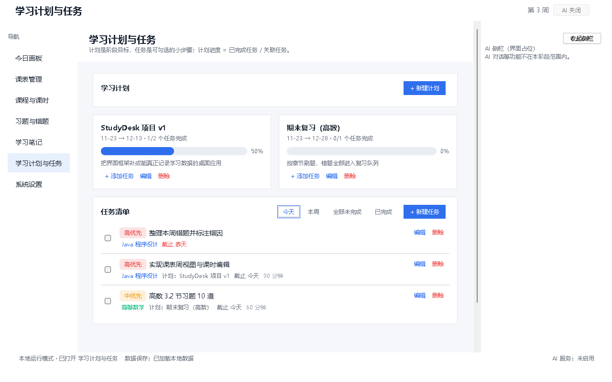
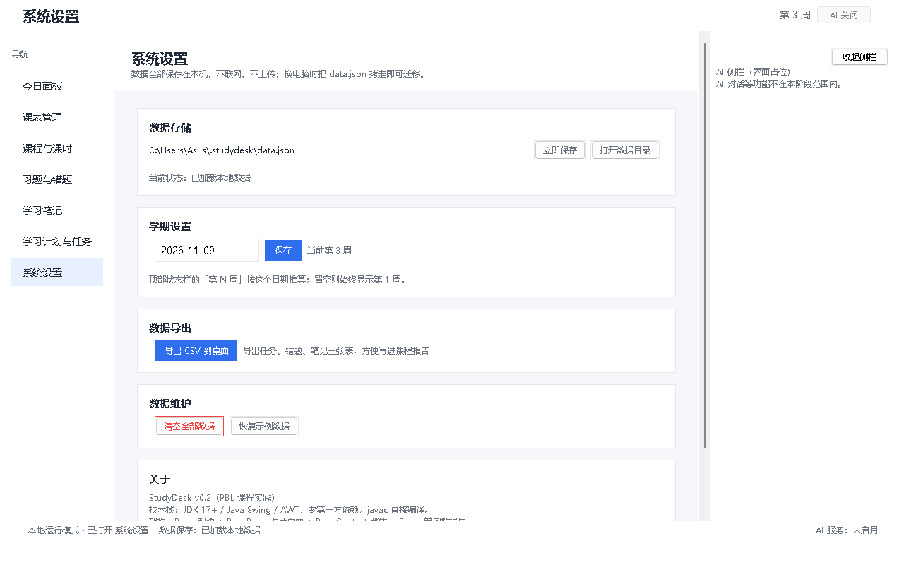

# StudyDesk 个人学习平台

基于 **Java Swing** 的桌面端个人学习管理工具，面向 PBL（项目式学习）课程实践。

技术栈只有 JDK 自带的 Swing / AWT，**不依赖任何第三方库**，不需要 Maven 或 Gradle，下载即编译。

> **版本状态**
> v0.1 完成的是界面框架与导航体系；**v0.2 已把七个模块的核心业务跑通**：
> 课程、课表、错题复习、笔记、计划任务都能真实录入并保存在本地，关掉再打开数据还在。
> **v0.2.3 补了数据安全**：保存改为原子写入 + 上一版自动备份，复习计数在答错时不再累加，
> 数据目录支持 `-Dstudydesk.home` 覆盖。右侧 AI 侧栏仍为占位，属于下一阶段。

## 拿到压缩包先看这里

本项目对外发两个包，用途完全不同，**别开错**：

| 压缩包 | 里面有什么 | 用来干什么 |
| --- | --- | --- |
| `1-StudyDesk-源码工程-用IDEA打开.zip` | `src/`（30 个 `.java`）、`.idea/`、`StudyDesk.iml`、`StudyDesk.jar` | **用 IDEA 打开这个**。这才是代码 |
| `2-StudyDesk-免安装运行版-双击exe即可.zip` | `StudyDesk.exe`、`app/`、`runtime/`（一堆 `.dll`） | 只想双击运行、不装 Java 时用。**里面没有源代码** |

如果你在编辑器里打开看到的是 `.dll`、`.jar` 或一堆二进制乱码，
说明打开的是第 2 个包（运行环境），请换第 1 个包。

## 界面预览

截图取自实际运行的程序（1280 × 800），对应仓库内的示例数据。

| 今日面板 | 课表管理 |
| --- | --- |
|  |  |

| 课程与课时 | 习题与错题 |
| --- | --- |
|  |  |

| 学习笔记 | 学习计划与任务 |
| --- | --- |
|  |  |

| 系统设置 |
| --- |
|  |

---

## 界面结构

主窗口采用固定的四区布局，各区域职责单一：

```
┌──────────────────────────────────────────────────────┐
│  顶部状态栏 TopBar（标题 / 第 N 周 / AI 开关占位）      │
├──────────┬──────────────────────────────┬────────────┤
│          │                              │            │
│  一级    │      内容区（可独立滚动）      │  右侧栏    │
│  导航    │      CardLayout 切换页面       │  AI 占位   │
│  Nav     │                              │  Side      │
│          │                              │            │
├──────────┴──────────────────────────────┴────────────┤
│  底部状态栏 BottomBar（操作反馈 / 保存状态 / AI 状态）  │
└──────────────────────────────────────────────────────┘
```

- **左侧一级导航**：七个主模块，点击即切换，当前页高亮。
- **中间内容区**：每个页面独立滚动，切换页面不影响导航栏与状态栏位置。
- **右侧栏**：预留 AI 助手位置，可折叠。
- **顶部 / 底部状态栏**：前者显示标题与周次，后者显示操作反馈与"已保存 HH:mm"。

## 七个功能模块

| 模块 | 标识 | 实现情况 |
| --- | --- | --- |
| 今日面板 | `TODAY` | 今日课程、今日待办（可直接勾选）、错题待复习、25 分钟专注计时 + 今日/本周时长、四项统计 |
| 课表管理 | `SCHEDULE` | 周一~周日 × 10 节的周视图；点空格子新增、点课时编辑、右键删除；保存前校验时间冲突 |
| 课程与课时 | `COURSES` | 课程增删改（名称/教师/主题色/备注）；卡片上显示课时、错题、待办、笔记数量；删课级联清理课时 |
| 习题与错题 | `EXERCISES` | 录入题干/答案/错因；按课程、掌握度、今日待复习筛选 + 关键词搜索；艾宾浩斯间隔复习 |
| 学习笔记 | `NOTES` | 增删改、课程归类、标签、置顶、关键词搜索、按更新时间排序 |
| 学习计划与任务 | `PLANS` | 计划（起止日期 + 进度条）；任务（优先级/截止日/预计耗时/关联课程与计划）；今天 / 本周 / 全部未完成 / 已完成 四个视图 |
| 系统设置 | `SETTINGS` | 数据文件路径、立即保存、学期起始日（决定"第 N 周"）、导出 CSV 到桌面、恢复示例数据、清空数据 |

### 三个跨模块的联动

1. **错题复习调度**：每复习一次，按 `1 / 2 / 4 / 7 / 15 / 30` 天把「下次复习」往后推；答"没记住"则退回未掌握、明天再来。复习满 3 次自动标记已掌握。
2. **计划进度**：不单独存进度字段，而是 `已完成任务 / 关联任务总数` 实时计算，勾选任务进度条立刻变化。
3. **今日面板聚合**：从课表取今天星期几的课时、从任务取今天到期（含逾期）、从错题取今天待复习，三处一点即跳转到对应模块并带上筛选条件。

## 数据与存储

- 位置（按优先级）：启动参数 `-Dstudydesk.home=<目录>` → 程序目录或其上一级存在 `data` 文件夹时的便携模式 → 默认 `用户目录/.studydesk/data.json`（Windows 为 `C:\Users\<你>\.studydesk\data.json`）。**纯本地、不联网**。
- 格式：手写极简 JSON（`Json.java`），带 `version` 字段，方便以后做数据迁移。
- 时机：任何增删改都会立刻落盘，底部状态栏显示"数据保存：已保存 10:38"。
- 写入：先写 `data.json.tmp` 并强制刷盘，再用 `ATOMIC_MOVE` 原子替换，写到一半崩溃也不会把主文件写坏；每次保存前把上一版留成 `data.bak.json`。
- 容错：主文件损坏时先改名成 `data.broken.bak`，再尝试用 `data.bak.json` 恢复；备份也不可用才重建示例数据，不会静默覆盖用户数据。
- 迁移：把 `data.json` 拷到另一台机器的同名目录即可；把免安装版和它同级的 `data` 文件夹一起拷走，就是绿色便携模式。
- 清空重来：删除 `.studydesk` 目录，或到「系统设置 → 恢复示例数据 / 清空全部数据」。
- 首次启动会写入一份示例数据（3 门课、6 个课时、3 道错题、3 条笔记、5 个任务、2 个计划），方便直接看效果。

## 目录结构

```
PBL_studyingdesk/
├── README.md
├── .gitignore
├── .gitattributes            固定换行规则：源码强制 LF、bat 强制 CRLF
├── .editorconfig             统一编码 / 缩进 / 换行规则（IDEA 自动识别）
├── StudyDesk.iml             IDEA 模块配置：src 为源码根、out 为输出目录
├── .idea/                    IDEA 工程配置（打开即用，含预置运行配置）
│   ├── misc.xml              JDK 与语言级别（JDK 11）
│   ├── modules.xml           模块登记
│   ├── encodings.xml         全局 UTF-8
│   ├── compiler.xml          编译参数
│   └── runConfigurations/
│       └── StudyDesk.xml     预置运行配置：studyDesk.StudyDeskApp
├── start.bat                  Windows 一键启动（首次自动编译打包，可选）
├── build.bat                  Windows 一键构建（javac + jar，可选）
├── docs/
│   ├── v0.2-迭代说明.md        本次迭代的目标、取舍与验证记录
│   └── screenshots/          七个页面的界面截图
└── src/
    └── studyDesk/
        ├── StudyDeskApp.java      程序入口，设置系统外观并启动主窗口
        ├── MainFrame.java         主窗口：四区布局、导航、页面栈、历史返回
        ├── PageId.java            七个一级页面的枚举
        ├── Page.java              页面契约接口
        ├── BasePage.java          页面基类：页头 + 卡片网格；进入页面时自动重画
        ├── PlaceholderPage.java   占位页（保留作新页面模板）
        ├── PageContext.java       页面向主窗口发起跳转的统一入口
        ├── TopBar.java            顶部状态栏
        ├── BottomBar.java         底部状态栏
        ├── AppTheme.java          全局配色、字体、间距常量
        ├── LightDialog.java       轻量弹窗基类
        │
        ├── Ui.java                控件工厂：卡片、按钮、圆角标签、自绘进度条、空状态
        ├── FormDialog.java        表单弹窗：标签 + 控件 + 取消/保存
        ├── Json.java              极简 JSON 读写（序列化 + 递归下降解析）
        ├── Dates.java             日期/周次工具（今天、本周、逾期、友好显示）
        ├── Store.java             数据仓库单例：CRUD + 持久化 + 变更通知
        │
        ├── Course.java            课程
        ├── Lesson.java            课时（星期 + 起止节次）
        ├── Exercise.java          错题（掌握度 + 复习次数 + 下次复习日）
        ├── Note.java              笔记
        ├── Task.java              任务（优先级 / 截止日 / 所属计划）
        ├── Plan.java              学习计划
        ├── FocusRecord.java       专注记录（番茄钟）
        │
        ├── TodayPage.java         今日面板
        ├── SchedulePage.java      课表管理
        ├── CoursesPage.java       课程与课时
        ├── ExercisesPage.java     习题与错题
        ├── NotesPage.java         学习笔记
        ├── PlansPage.java         学习计划与任务
        └── SettingsPage.java      系统设置
```

## 运行方式

要求 **JDK 11 及以上**（本版在 JDK 25 上编译运行通过）。

整个项目是**纯 Java 实现**：只用 JDK 标准库（`java.*`、`javax.swing.*`），
不依赖任何第三方 jar，也不需要 Maven / Gradle —— `javac` 能直接编译。

### 方式一：IntelliJ IDEA（推荐）

仓库里已经带好了完整的 IDEA 工程配置，不需要手工设置源码目录：

1. `File → Open`，选中项目根目录（和 `StudyDesk.iml` 同一层），点 OK；
2. 等右下角索引跑完，`src` 会自动显示为蓝色源码根；
3. 右上角运行配置下拉框选 **StudyDesk**，点绿色三角运行。

如果 IDEA 提示 `Project SDK is not defined`，只需一次设置：
`File → Project Structure → Project → SDK`，选本机 JDK（11 及以上），
`Language level` 保持 `11` 即可。

### 方式二：命令行（只用 javac / java）

```bash
git clone https://github.com/venusooooo/PBL_studyingdesk.git
cd PBL_studyingdesk

# 编译，产物输出到 out/
javac -encoding UTF-8 -d out src/studyDesk/*.java

# 运行
java -cp out studyDesk.StudyDeskApp
```

想打成可执行 jar：

```bash
jar --create --file StudyDesk.jar --main-class studyDesk.StudyDeskApp -C out .
java -jar StudyDesk.jar
```

### 方式三：Windows 双击（不想碰命令行时用）

双击 `start.bat`：首次运行会自动编译并打包出 `StudyDesk.jar`，然后启动主窗口，之后秒开。
`build.bat` 只做构建（等价于上面的 `javac` + `jar`）。

这两个脚本只是图省事，**删掉它们项目照样能编译运行**，不影响"纯 Java"。

### 方式四：免安装 exe（评审 / 给别人演示）

用 JDK 自带的 `jpackage` 可以把程序连同精简运行时打成一个文件夹，
**目标机器不需要装 Java**，双击 `StudyDesk.exe` 即可：

```bash
jpackage --type app-image --name StudyDesk --app-version 0.2 \
         --input dist-input --main-jar StudyDesk.jar \
         --main-class studyDesk.StudyDeskApp \
         --java-options "-Dfile.encoding=UTF-8" \
         --dest dist
```

产物在 `dist/StudyDesk/`（约 120 MB，绝大部分是内置的 JRE），整个文件夹拷走就能用。

> Windows 终端编码不是 UTF-8 时，源码里的中文注释可能触发编译警告，加 `-encoding UTF-8` 即可。

## 代码规范

项目按统一的 Java 编码规范组织，规则写在 `.editorconfig` 里，IDEA 打开后自动生效：

| 项目 | 规范 |
| --- | --- |
| 文件编码 | UTF-8，无 BOM |
| 换行符 | LF（`.bat` 保持 CRLF，由 `.gitattributes` 强制） |
| 缩进 | 4 个空格，不使用 Tab |
| 行尾 | 不允许空白字符；文件末尾保留一个空行 |
| import | 按包名字母序排列，不使用未引用的导入 |
| 序列化 | 继承 Swing 组件的类统一声明 `serialVersionUID` |
| 包结构 | 所有类位于 `studyDesk` 包，对应目录 `src/studyDesk/` |

规则写在两个文件里，换机器也不会漂移：

- `.editorconfig` —— 给编辑器 / IDEA 看：编码、缩进、换行、末尾空行；
- `.gitattributes` —— 给 Git 看：`*.java` 强制 `eol=lf`，`*.bat` 强制 `eol=crlf`。
  这一条很关键，否则 Windows 上 `core.autocrlf=true` 会把源码在 checkout 时又改回 CRLF，
  commit 一次就白改了。

用 IDEA 的话，`Ctrl + Alt + L`（格式化代码）和 `Ctrl + Alt + O`（优化导入）
可以随时把任何文件重新对齐到这套规则。

## 架构说明

框架的核心是**页面与主窗口解耦**，新增业务功能时不必改动主窗口。

**页面契约 `Page`**

```java
public interface Page {
    PageId getId();
    String getTitle();
    JComponent getView();
    default void onShow(Map<String, Object> params) { }
    default void onHide() { }
    default Map<String, Object> saveState() { return new HashMap<>(); }
    default void restoreState(Map<String, Object> state) { }
}
```

**页面基类 `BasePage`**

固定「页头 + 卡片网格」结构，内容区交给 `JScrollPane` 独立滚动。子类只需实现 `buildContent()`，用 `addCard(卡片, 行, 列)` 摆放卡片即可。

`buildContent()` 在每次进入页面时都会重新执行（数据可能已变），因此**只创建组件、不写一次性状态**；页面内部改动数据后调用 `refresh()` 原地重画。

**数据仓库 `Store`**

```java
Store store = Store.get();
List<Course> courses = store.courses();
store.addTask(new Task("写答辩稿"));
store.review(exercise, true);   // 记录一次"记住了"的复习
```

所有页面都只跟 `Store` 打交道，不直接读写文件；`Store` 负责 CRUD、`save()` 落盘与变更通知。

**页面上下文 `PageContext`**

页面不直接操作 `MainFrame`，而是通过注入的 `PageContext` 发起动作：

```java
void navigateTo(PageId id, Map<String, Object> params);
void back();
void openDialog(JDialog dialog);
void setStatus(String text);
```

**新增一个业务页面的步骤**

1. 继承 `BasePage`，实现 `getId()` 与 `buildContent()`；
2. 在 `MainFrame.initPages()` 里把新页面加入数组；
3. 页面内部通过 `context().navigateTo(...)` 跳转，不要直接引用 `MainFrame`。

**样式统一**

所有颜色、字号、间距集中在 `AppTheme`，控件统一由 `Ui` 生成，页面里不写魔法数字。

## 当前进度

- [x] 主窗口四区布局与尺寸规范
- [x] 七个模块的一级导航与页面切换
- [x] 页面栈与返回、状态保存恢复机制
- [x] 全局主题常量
- [x] **数据模型与本地持久化（JSON）**
- [x] **今日面板：课程 / 任务 / 错题 / 专注聚合**
- [x] **课表周视图与课时增删改**
- [x] **课程管理（含级联清理）**
- [x] **错题本 + 艾宾浩斯复习调度**
- [x] **学习笔记（搜索 / 标签 / 置顶）**
- [x] **学习计划与任务（进度条 / 四视图筛选）**
- [x] **系统设置（数据路径 / 周次 / CSV 导出 / 维护）**
- [ ] 右侧 AI 助手接入
- [ ] 单双周课表、单元测试、数据云同步

## 已知限制

- 课表只按"每周固定"排课，暂不支持单双周 / 调课周。
- 复习提醒只在应用内可见，没有系统通知或日历集成。
- 笔记是纯文本，没有 Markdown 渲染与富文本。
- 数据明文存放在本地，没有加密与多端同步。
- 目前靠手工点检与临时脚本做冒烟验证，还没有 JUnit 测试。

## 说明

本项目为课程 PBL 实践作品。v0.2 的目标是"先把核心功能做出来、能真实用起来"，因此优先保证数据正确与交互闭环，视觉细节与边界情况会在后续迭代继续打磨。
